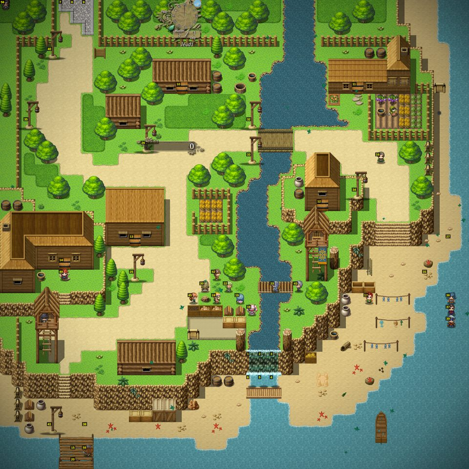

# La plage — le Village de Pêche (carte 33), l'analyse avant d'y toucher

JOKO, 2026-11-09 : *« maintenant à la plage. Parce qu'il y a peut-être un peu trop de personnages, ou peut-être trop
de choses […] c'est un côté que j'ai pas du tout fait […] aucune idée, donc une grosse analyse, ce serait bien quand
même savoir ce qu'on pourrait mettre dedans »*, puis *« même pour les PNJ »*.

**Fait le 2026-11-09**, sur ta réponse : *« Mer plutôt, oui , le ponton c'est juste un theaseur de dono et de lore il
connaît des choses qu'il devrait pas connaît tu le vois que le soir-lui, bible, tout et développe ou détail au maximum »*.
Ce qui a été posé est dans CLAUDE.md (« La plage ») ; ce document reste l'analyse d'avant. Les questions sans réponse ont pris
la recommandation, réglable : Erwan (le Pêcheur) père de Jonas et de Sora, les quêtes des ✎ à Sora et à Orin, le Fil du Fond
une partie sur dix, les poissons sur tes trois images, Edwin fils d'Annick (ton commentaire), 18 ans (ton en-tête).

---

## 0. En deux mots

- **Pas trop de monde, mais pas les bonnes personnes, au mauvais endroit.** À midi et le soir, 7 personnes sur 12
  tiennent dans un carré de 7 × 5 cases, sur le petit pré de l'étal (les photos). Et le village de pêche n'a **aucun
  pêcheur qui y habite** : sur 10 habitants, 2 élèves de Rubis, un Essayeur en tournée, un capitaine, un paysan.
- **Pas trop de choses, mais rien à y faire.** La carte est belle et pleine (la rivière, la cascade, le ponton, les
  séchoirs, la barque). Sur le sable, rien ne se ramasse et rien ne change d'un jour à l'autre. Ta pêche (Galv) n'a
  que 2 poissons et une pierre, et ses poissons ne sont pas des poissons.
- **Une question avant tout : un lac ou la mer ?** Ta Bible met Aurevel au centre du continent, et la mer chez
  Ilmarée. Ta capitale est au-dessus d'un lac. Ton propre texte d'Oshka dit « le silence du Lac ». Le décor, lui,
  est marin (vagues, étoiles de mer).
- **Ce que la plage peut devenir** : « le village d'où part l'expédition », au bord du lac, avec une famille de
  pêcheurs au cœur. La plage change chaque matin (ce que l'eau ramène), la pêche sert à quelque chose (Annick
  achète, un carnet, le concours que le tableau d'affichage annonce déjà), et un soir calme, celui du départ.

---

## 1. Ce qu'il y a aujourd'hui (mesuré dans le jeu)

*Midi, photo prise dans le vrai jeu ; les numéros sont ceux des événements. À 8 h (`images/plage_8h.jpg`), chacun
est à son poste et le village respire.*

### La carte

40 × 40, tuiles « mer » (`Tileset_Beach_Rasak`). Au nord, l'entrée par la route pavée (vers le Marché). Ensuite :

- cinq maisons, dont quatre fermées où l'on frappe et quelqu'un répond, et la Maison 2, ouverte de 6 h à 22 h ;
- une ferme au potager clôturé (Gaston) et un champ de blé ;
- une rivière qui coupe le village, avec deux ponts, puis une cascade qui tombe dans l'eau ;
- deux tours de guet, un étal (les caisses au centre), huit réverbères ;
- à l'est, la plage : trois séchoirs à poissons, des jarres, une barque à l'eau, des coquillages et des étoiles de
  mer ;
- au sud-ouest, le ponton.

### Les gens

| | Qui | D'où |
|---|---|---|
| 16 | **Jonas**, 18 ans, recrue de la garde, fils de pêcheur | l'outil |
| 17 | **Orin**, 64 ans, ravaude les filets | l'outil |
| 18 | **Emma Fieldensong**, 17-18 ans, Rubis, « la Princesse » (dort à l'auberge) | ta fiche, l'outil |
| 19 | **Sora**, 8 ans, coquillages, « fille du pêcheur » | ta fiche, l'outil |
| 22 | **Edwin Bramble**, Rubis, fils d'Annick | ta fiche, l'outil |
| 23 | **Régis**, 76 ans, capitaine à la retraite | l'outil |
| 24 | **Annick**, 46 ans, femme de pêcheur, mère d'Edwin | l'outil |
| 42 | **Gaston**, paysan | **à toi** (repris) |
| 43 | **Gustave**, Essayeur de la Confrérie des Reliquaires, en tournée (dort à l'auberge) | l'outil |
| 45 | **Solange**, 33 ans, voiles, trois humeurs | l'outil |
| 30 | **Grod**, l'ivrogne (`<NPC: ivrogne>`, la quête « rumeurs ») | **à toi** (août) |
| 31 | **Le Pêcheur**, la pêche de Galv | **à toi** |
| 20 | **le masqué** au bout du ponton (« tu la vois toi aussi ? ») | **à toi** (août) |
| 15 | **l'âme d'Oshka**, sur le ponton, avec l'interrupteur 46 | **à toi** (août, les Sept Noms) |
| 36, 37, 39 | **✎ Fille, Vieux, Femme du pêcheur** : trois quêtes d'exemple de l'atelier | l'atelier |
| — | de passage : **Roul** (pêche au ponton 5-13 h), **Ninon** (midi), **Colette** (le soir) | |

**Mesuré** (le jeu, beau temps) : 14 personnes visibles à midi, 13 à 19 h. À midi comme à 19 h, **7 d'entre elles
sont dans 7 × 5 cases**, entre (15,22) et (21,26), sur le petit pré de l'étal. C'est la « place » de VieDuVillage,
le centre de leurs postes. Le reste de la carte, la plage comprise, est vide à ces heures-là.

Ce qui frappe :

- **Aucun pêcheur n'habite le village de pêche.** Ceux qui vivent de l'eau sont Orin (filets), Annick (elle vend
  le poisson), Solange (voiles) et Sora (coquillages). Les pêcheurs sont de passage (Roul, du bar) ou sans nom (ton
  Pêcheur). Barnabé, le charpentier de barques, a été retiré, comme les cinq gardes du port.
- **Les trois ✎ sont debout dans l'eau** (x 38, y 25-27, sur la photo à droite). Leurs rôles existent déjà chez
  de vrais habitants : la « fille du pêcheur », c'est Sora ; la « femme de pêcheur », c'est Annick.
- **La moitié des habitants ne sont pas d'ici** : Emma et Gustave dorment à l'auberge, et Edwin passe sa vie à
  l'académie (la Bible : *« La Grande Bibliothèque […] Edwin Bramble y vit presque »*).

### Ce qu'on peut y faire

- **Pêcher** (ton Pêcheur, `GALV_Fishing`) : l'étang reçoit 3 à 6 poissons « verts », 1 à 3 « violets » et une
  pierre. Sur les 50 places du réglage, **3 sont remplies** : vert, violet, la pierre. ⚠ **Le poisson vert donne le
  Fil du Fond** (108, *« matériau rare — butin de boss »*, +12 % AGI et CHA à la forge), et le violet une Bricole
  (103). Une partie de pêche peut rapporter plusieurs matériaux de boss. Est-ce voulu ?
- **Les quêtes** : « Des lucioles pour le pêcheur », « Le chant du lac » et « La chaîne des échanges » (les trois ✎) ;
  « rumeurs » (Grod) ; Oshka et les Sept Noms (l'ancien système « Zikhrael », dont le plugin n'est plus là : ses
  commandes ne répondent pas).
- **Les portes** : quatre maisons où l'on frappe, et la Maison 2.
- **Les scènes « 🏘 »** (14) : Emma et Edwin, Annick et son fils, Régis et ses campagnes, Sora et ses coquillages,
  Orin, Gustave, Roul au ponton, Colette le soir, Jonas, Solange (deux), Ninon, Edwin et le vent de la grotte. Celle
  de Barnabé dort (il n'est plus là).

### Les incohérences trouvées

| | |
|---|---|
| **Lac ou mer** | « lac » : le tableau d'affichage (*« Concours de pêche au lac »*), Oshka (*« le silence du Lac »*), la quête « Le chant du lac », « ✎ Rive du lac », les fiches d'Emma et d'Edwin. « mer » : la fiche de Jonas (*« la mer à l'aube »*). Barnabé rêvait de « longer la côte de l'est », celle d'Ilmarée. Le décor, lui, est marin. |
| **L'âge d'Emma et d'Edwin** | tes en-têtes : 18 ans ; leurs fiches OC : 17. |
| **La famille d'Edwin** | la Bible : *« Issu d'une famille modeste d'érudits et d'archivistes »* ; le jeu (ton commentaire) : le fils d'Annick, femme de pêcheur. |
| **Les ✎ dans l'eau** | trois exemples d'atelier debout sur l'eau, qui doublent Sora et Annick. |

---

## 2. Ce que dit le lore

| La Bible | Ce que ça donne pour la plage |
|---|---|
| Aurevel : *« Châteaux de pierre, terres agricoles fertiles, rivières, forêts et villes fortifiées »* ; *« placé au centre »*. | Aurevel n'a pas de côte. |
| Ilmarée : *« Marbre, marchés, ports et domaines luxueux sur la côte de l'est »* ; *« Les navires d'Ilmarée longent les côtes de l'est. »* | La mer est chez Ilmarée, loin. |
| Haute-Taville, *« bâtie sur des falaises au-dessus d'un lac »* ; la Basse-Brume, *« au bord du lac, sous une brume légère qui luit la nuit »* ; la Sirène Salée, *« au bord du lac »* ; *« Les quais […] les courses de barques de Brynja et Corentin »*. | **La capitale a un grand lac, avec des quais et des barques.** Un village à une demi-journée, au bord de ce lac, est ce qu'il y a de plus cohérent. |
| *« Le village du donjon des eaux. Le point de départ de la première expédition d'Edwin Bramble et d'Aël, encadrée par la garde royale, avec Vesper et Ludwig. »* ; *« Edwin part pour sa première faille depuis le village du donjon des eaux »*. | Edwin habite ici (le fils d'Annick) : **c'est sa maison que l'expédition quitte.** |
| *« tous partent pour leur première faille sauvage autour de la sixième, encadrés par la garde royale »* | La garde royale vient chercher les élèves **ici**. |
| Les Larmiers (Notion) : la Tristesse, *« la pluie tombe, l'eau monte »* ; la faille s'ouvre sur l'Étang-Miroir. | L'eau de l'autre côté. Le village ne le sait pas (le niveau 1, le nom : à l'expédition de le découvrir). |
| L'Académie : *« La nuit, elles luisent d'un rouge sourd qui a donné son nom à l'école. »* | (Une idée, pas le lore : de la plage, la nuit, une lueur rouge sur l'autre rive. P7.) |
| *« Ils vivent de la terre, de l'artisanat ou du commerce, et regardent les aventuriers avec un mélange d'admiration et de crainte. »* | Des pêcheurs, des ravaudeurs, une poissonnière : des gens ordinaires. |
| Le Quartier Noyé : *« une Cicatrice fermée par une enceinte, dont les dossiers restent politiquement sensibles. C'est là que Donovano a gagné son titre de Héros »*. | L'eau qui a noyé un quartier de la capitale. Et le masqué du ponton porte l'image « dono » : **à toi.** |

**Ma lecture :** la plage est **la rive du lac de Haute-Taville**, ou d'un grand lac de la région. La Bible le
veut (Aurevel au centre, la capitale au-dessus d'un lac), et tes textes à toi le disent déjà (« le Lac » d'Oshka,
le concours « au lac »). Seules quelques tuiles (les étoiles de mer) et la fiche de Jonas parlent de la mer. Si tu
préfères la mer, il faut dire comment Aurevel touche la côte : la Bible ne le dit pas.

---

## 3. Ce que font les autres jeux (et ce que les joueurs en retiennent)

- **Stardew Valley.** La plage est une **promenade de tous les jours** : on y ramasse ce que la mer a laissé, Willy y
  vend ses cannes, un vieux marin n'y apparaît **que sous la pluie**. Sa fête la plus aimée, la Danse des Méduses au
  Clair de Lune, **ne donne rien** : tout le village regarde passer les méduses, la nuit. Les guides la disent
  *« beloved and memorable […] despite offering no material rewards »*. Pas de concours, pas de récompense : un
  moment ensemble.
- **Animal Crossing.** **Chaque jour, quelque chose arrive par l'eau** : des bouteilles avec la lettre d'un habitant
  (une à deux par jour), un personnage échoué qu'on aide (Gulliver), une loutre qui échange les pétoncles qu'on lui
  rapporte (Pascal). On revient voir la plage chaque matin parce qu'elle a changé.
- **Link's Awakening.** La scène de Marin sur la plage : on s'assoit à côté d'elle, on regarde l'eau, elle parle de
  ce qu'il y a au-delà. *« whimsical and silly yet strangely poignant »* : un seul moment calme, dont tout le monde
  se souvient.
- **La pêche, ce que les joueurs en disent.** Ils aiment une pêche **simple à commencer**, qui **sert à quelque
  chose** (vendre, une collection, un concours) et qui **change avec l'heure, la météo et le lieu**. Ils détestent
  une pêche **obligatoire**, qui **bloque un objet important**, qui fait **perdre du temps**, ou qui n'est
  « de la pêche que par le nom ».

**Ce qui en ressort pour nous :**
1. une plage qui **change chaque jour** ;
2. **un moment calme**, une fois, sans récompense ;
3. une pêche **facultative mais utile** ;
4. **des gens qui n'apparaissent qu'à une heure ou par un temps**.

---

## 4. Le diagnostic : trop de personnages ? trop de choses ?

**Pas trop de personnages en nombre** : 10 habitants sur 40 × 40 (la Ville en a 15 sur la même taille). Mais :

1. **ils sont au mauvais endroit** : la place de midi et du soir tombe sur un pré de 7 × 5 cases, et la plage
   reste vide ;
2. **ils ne sont pas d'ici** : un village de pêche sans pêcheur, la moitié des gens de passage, et chacun son
   histoire sans lien avec l'eau (le sabre de Régis, les reliques de Gustave, le classement d'Emma) ;
3. **il y a des doubles et des restes** : les trois ✎ dans l'eau, Grod (un ancien `<NPC:>` dont la quête parle de
   « l'aubergiste »), la marque « colette ».

**Pas trop de choses à voir, mais rien à faire** : le décor de la plage (séchoirs, barque, coquillages) est muet.
La pêche existe, mais sans but : ses deux poissons sont des matériaux, et rien ne s'achète, ne se compte ni ne se
gagne.

**La correction n'est pas d'ajouter du monde.** Il faut moins de gens, mais plus vrais, à leur place, et que la
plage serve à quelque chose.

---

## 5. Les idées

Chaque idée dit d'où elle vient et ce qu'il faut pour la faire. « Contenu » : des répliques et des événements par
les outils, comme pour la Ville. « Mécanique » : un plugin, à te proposer d'abord. « Carte » : à toi, dans
l'éditeur.

### P1 — Une identité : le village d'où part l'expédition
*La Bible (le village du donjon des eaux, la garde royale, Edwin).* C'est **le** village où la première expédition
prend la route : la maison d'Edwin, la mère qui attend, la garde qui vient chercher les élèves. Toutes les idées
suivantes y sont accrochées. **Il faut :** ta réponse sur lac / mer (Q1).

### P2 — Une famille de pêcheurs au cœur de la plage
*Leurs fiches le disent déjà.* Jonas est « fils de pêcheur » : *« son père vient le regarder de loin tous les
matins »*, *« celle de papa est la troisième »* (barque). Sora est « fille du pêcheur » et appelle son plus beau
coquillage « Papa ». **Ton Pêcheur (31), sur la plage, serait leur père.** À l'aube, il part sur la barque ; Jonas,
sur la tour de guet, la regarde partir ; Sora l'attend sur le sable. Le père qui pêche, le fils qui a choisi la
garde : la plage a un cœur. **Il faut :** ton accord, un nom pour lui (Q2). C'est ton événement : sa pêche ne
change pas, ses mots s'ajoutent autour.

### P3 — Ce que l'eau ramène, chaque matin
*Animal Crossing, Stardew.* Chaque matin, une ou deux choses sur le sable, à un endroit différent : un coquillage
(pour Sora), du bois flotté, un objet perdu, **une bouteille avec une lettre**.

La rivière qui traverse le village vient du nord, de la Ville. **Élise (9 ans, la Ville) jette des bouteilles dans
la rivière, et Sora (8 ans, la plage) les trouve.** Deux enfants qui ne se sont jamais vues s'écrivent par la
rivière, et le joueur peut porter les réponses. **Il faut :** une petite mécanique, « ce que l'eau ramène » (des
cases de plage, une liste d'objets, un tirage par jour), et les lettres.

### P4 — La collection de Sora
*Sa fiche : « elle a donné un nom à chaque coquillage ».* On lui rapporte les coquillages de P3 ; elle les nomme
(« Celui-là, c'est toi »), et le dernier mène à la scène du coquillage « Papa ». **Il faut :** du contenu (une
quête par étapes, ses scènes d'amitié).

### P5 — Une pêche qui sert à quelque chose
*Les joueurs : simple, utile, variée selon l'heure, facultative.* La pêche de Galv est déjà là, il manque :
- **des poissons de lac**, par heure, saison et météo : gardon, perche, brochet (le brochet de Roul *« gros comme
  sa jambe »*, qui était une perche, existe déjà dans les répliques), carpe, tanche, anguille (la nuit), truite (le
  printemps), sandre (le soir). Et **un poisson de légende** dont tout le village parle et que Régis jure avoir
  vu ;
- **à quoi ils servent** : Annick les achète (*« revendre le poisson de Roul plus cher qu'il ne croit »*, sa
  fiche), « Voir mes prises » garde les records (Galv le fait déjà) ;
- **jamais obligatoire** : aucun objet de l'histoire derrière.

**Il faut :**
- une image par poisson dans `img/fishing` : il n'y a que `green`, `purple` et `rock`. Ce sont tes images : je
  n'en ajoute pas ;
- ta réponse sur le Fil du Fond du poisson vert (Q6).

### P6 — Le concours de pêche
*Ton tableau d'affichage l'annonce déjà : « Concours de pêche au lac. Roul et Tobin sont inscrits. La garde sera
présente. »* Roul et Tobin sont rivaux depuis le lot du bar. Un jour par saison (un réglage, comme la Veillée),
tout le village est sur la plage, chacun pêche, le plus lourd gagne (Galv pèse déjà les prises), et Régis juge. Un
festival à la Stardew, déjà écrit dans ton jeu. **Il faut :** une scène « 🏘 » longue, le jour en réglage, la pesée
lue dans les records de Galv.

### P7 — Le soir où ils partent
*Link's Awakening, la Danse des Méduses : un moment calme, sans récompense.* À l'étape 2 du village (variable 889,
les aventuriers arrivent), la veille du départ, au coucher du soleil : Edwin et Annick au bout du ponton, et ses
tartines « contre la faille » (sa fiche). On peut **s'asseoir avec eux**. Il ne se passe presque rien, et c'est le
moment. Ensuite :
- à l'étape 3, Annick attend chaque soir sur le ponton ;
- à l'étape 4, Edwin lui explique tout, pendant trois heures, sans qu'elle l'arrête : *« qu'Edwin rentre de sa
  faille et lui explique tout, pendant trois heures »*, c'est le rêve de sa fiche.

Si c'est le lac de la capitale, une lueur rouge sur l'autre rive, la nuit (les tours de Rubis, *« d'un rouge
sourd »*), et Edwin qui dit « c'est l'école ». **Il faut :** du contenu (scènes, étapes) et ton accord sur la
lueur, qui est une image (Q1).

### P8 — Midi sur le sable
*La mesure de la partie 1.* À midi, les pêcheurs mangent sur le sable près des barques, les enfants sont au bord
de l'eau et les vieux sur le ponton ; le soir, la place. Plus de pré bondé, une plage habitée. **Il faut :** une
mécanique, des « places » par carte et par heure (`<Place: 31,27 12-13>`). VieDuVillage ne prend aujourd'hui qu'un
seul point, le centre des postes.

### P9 — Les jours de pluie
*Stardew : le vieux marin, seulement sous la pluie.* Sous la pluie, on rentre les barques et la plage se vide. Il
reste quelqu'un : Orin sous l'auvent avec ses filets, ou Solange, un jour « poétique », qui regarde l'eau grise.
Une personne qu'on ne voit que ce jour-là. Pas de Tristesse de faille ici : elle est loin (la Bible, l'imprégnation
*« près d'une faille »* ; la tristesse est réglée à 8 % au village de pêche). **Il faut :** du contenu.

### P10 — Les étapes du village, à la plage
*Habitants v1.5, la variable 889.*

| Étape | À la plage |
|---|---|
| 1 · la garde royale s'installe | Jonas monte enfin sur la tour, Régis passe la garde en revue. |
| 2 · les aventuriers arrivent | Ils viennent acheter du poisson et louer des barques ; Annick monte ses prix. |
| 3 · l'expédition est entrée | Annick attend sur le ponton. |
| 4 · elle est revenue | Gustave a enfin des reliques à examiner (la Bible : la Confrérie des Reliquaires et *« ce qu'on en rapporte »*). |

**Il faut :** du contenu.

### P11 — Le ponton : ton mystère (à toi seul)
Au bout du ponton, le masqué à l'image « dono » demande *« tu la vois toi aussi ? »*. À côté, l'âme d'Oshka
apparaît avec l'interrupteur 46, et *« chantait pour couvrir le silence du Lac »*. Sora, dans sa fiche, a peur
« du monsieur au masque, au bout de la plage ». C'est **la seule idée vraiment à part** de la carte, et elle est à
toi. **Je n'écris rien dessus sans toi** (Q4) : est-ce que ça vit encore (les Sept Noms datent d'août, leur plugin
n'est plus là), et qui est le masqué ?

### P12 — Désencombrer
- Les trois ✎ dans l'eau : leurs quêtes vont à ceux qui ont déjà ces rôles. Les lucioles à Sora (« la fille du
  pêcheur »), la chaîne des échanges à Annick (« la femme de pêcheur »), le chant du lac à Orin (« le vieux
  pêcheur »). Les ✎ quittent la plage (à toi, Q3).
- Grod : un vrai habitant (l'ivrogne du port, « J'bois pas. J'goûte. »), ou au bar (Q5).
- Gustave et Emma restent, mais **pour une raison** : Gustave attend ce que l'expédition rapportera, Emma est
  venue voir Edwin avant le départ.

---

## 6. Les PNJ, un par un

Le gabarit de la Ville (`docs/PNJ_LA_BASE.md`, partie 6) : une histoire tirée d'un fait de la Bible à la mesure de
l'âge, ce qu'il sait et ignore, une voix, une question au joueur, ses lignes à chaque étape. Les dates : la
révolution il y a un peu plus de vingt ans, la famine de Thibaut avant elle, la Marche il y a une trentaine
d'années, le Quartier Noyé « ces dernières années ».

| Qui | Ce que je garde | La direction proposée |
|---|---|---|
| **Le Pêcheur** (à toi) | sa pêche | Le père de Jonas et de Sora (P2). Il parle peu : il dit le temps qu'il fera sur l'eau. |
| **Jonas**, 18 | timide, « Papa pêche. Moi, je monte la garde. » | Né sous Lothaire, il a grandi avec la légende du Héros : c'est pour ça qu'il a choisi la garde. Son père ne le lui a jamais reproché, et c'est pire. |
| **Sora**, 8 | les coquillages, « T'as vu celui-là ?! » | Elle ne connaît que le Héros et les histoires. Sa collection (P4), ses bouteilles avec Élise (P3), sa peur du masqué (à toi). |
| **Annick**, 46 | bavarde, « Tu as mangé ? », les tartines | Elle était jeune fille sous la famine de Thibaut : c'est **pour ça** qu'elle demande « Tu as mangé ? » à tout le monde (ce n'est pas la même faim que Rolf, en ville : elle, elle nourrit). Le départ d'Edwin est son fil (P7). |
| **Edwin**, 18 | la Bible, ses lunettes, « Pose-la-moi ! » | Il part d'ici (la Bible). La famille de la Bible (« érudits et archivistes ») contre le fils d'Annick : à toi (Q7). |
| **Orin**, 64 | taiseux, un nœud par phrase, le nœud-étoile | Pendant la famine, il avait une quarantaine d'années, et les filets nourrissaient ceux qui avaient une barque. Il en a gardé l'habitude de ne rien jeter. Il hérite du « vieux pêcheur » et du chant du lac (P12). |
| **Solange**, 33 | trois humeurs, « c'est pas moi, c'est la faille » | Avant la faille, elle accusait le vent d'ouest. Elle recoud les voiles des barques. |
| **Régis**, 76 | grandiloquent, le sabre « de légende » | Au lieu d'un capitaine de quoi on ne sait quoi : un ancien officier de la **garde royale**, qui a encadré des premières failles d'élèves pendant trente ans (la Bible : *« encadrés par la garde royale »*). Cette fois, l'expédition part de chez lui, et il n'y va pas. Il juge le concours (P6). |
| **Gustave**, 48 | la loupe, les faux sceaux | Il attend l'étape 4 : ce que l'expédition rapportera. En attendant, il examine les casseroles. |
| **Emma**, 18 | « Tu peux partir. Je t'y autorise. » | Venue voir Edwin avant le départ. Elle s'entraîne seule au bord de l'eau, et ses mains tremblent (sa fiche) : une scène d'amitié au crépuscule, la flamme qui file sur l'eau. |
| **Gaston** (à toi) | — | Pas touché. |
| **Grod** (à toi) | « J'bois pas. J'goûte. » | Q5. |
| **Visiteurs** | Roul au ponton le matin, Ninon à midi, Colette le soir | Roul et Tobin au concours (P6). |

Comme pour la Ville, chaque PNJ aurait sa voix, son fil, sa question, ses lignes de tristesse et ses étapes. Aucune
réplique ne serait partagée entre deux PNJ, et le banc `les_gens_du_village` les contrôlerait.

---

## 7. Les questions

1. **Lac ou mer ?** Je propose le lac, celui de la capitale ou un grand lac voisin : la Bible le veut, et ton
   Oshka le dit déjà. Si c'est la mer, comment Aurevel touche-t-il la côte ?
2. **Le Pêcheur (31), père de Jonas et de Sora ?** Et son nom.
3. **Les trois ✎ dans l'eau** : leurs quêtes vont à Sora, Annick et Orin, et les ✎ quittent la plage ?
4. **Le ponton** (le masqué « dono », Oshka, les Sept Noms) : est-ce que ça vit encore, et qui est le masqué ? Je
   n'y écris rien sans toi.
5. **Grod** : habitant du village de pêche, ou au bar ?
6. **La pêche** :
   - le poisson vert qui donne le Fil du Fond (un matériau de boss, 3 à 6 par partie), c'est voulu ?
   - les poissons de lac (P5) : tu as des images, ou je reprends le vert et le violet sous d'autres noms ?
7. **Edwin** : le fils d'Annick (le jeu) ou une famille d'érudits (la Bible) ? Et Emma et lui : 17 ou 18 ans (je
   prends ton en-tête : 18) ?
8. **Lesquelles des idées** P1 à P12 ? Je recommande, dans l'ordre :
   1. **P1 + P2 + P12**, les bons gens à leur place ;
   2. **la refonte des PNJ** (partie 6) ;
   3. **P5 + P6**, la pêche et son concours ;
   4. **P3 + P4**, ce que l'eau ramène ;
   5. **P7**, le soir du départ ;
   6. **P8**, midi sur le sable (une mécanique, à part).

---

*Sources des jeux : le wiki de Stardew Valley (la Danse des Méduses), theriagames.com et sportskeeda.com (ses
guides) ; nookipedia.com (les bouteilles), imore.com et nintendo-insider.com (Gulliver) ; zeldawiki.wiki et
zeldauniverse.net (Toronbo Shores, Marin), destructoid.com ; sur la pêche : gamedevsjourney.substack.com,
automaton-media.com, pcgamer.com, comicbook.com, inverse.com (Sea of Stars). Mesures : le jeu lui-même (Playwright,
carte 33, beau temps, 8 h, midi, 19 h).*
